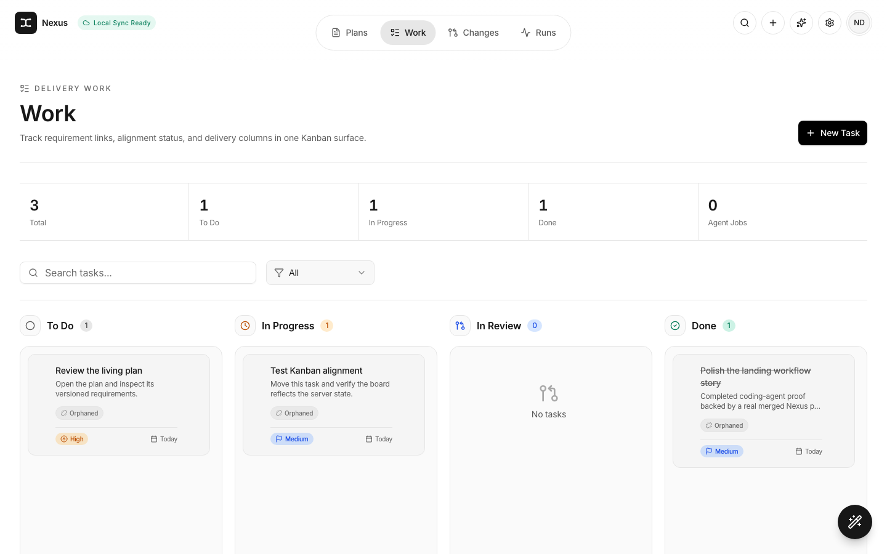

# Nexus

[](https://github.com/zexy2/Nexus/actions/workflows/ci.yml)
[](https://github.com/zexy2/Nexus/releases)
[](LICENSE)

Project workspace that turns plan edits into task updates you approve before they reach the board.

[Live demo](https://nexus.zekiakgul.dev) · [Case study](https://zekiakgul.dev/work/nexus/) · [Release notes](https://github.com/zexy2/Nexus/releases)



> **Status:** public demo on a single VPS. Signup is closed; "Try Demo" creates an isolated workspace with server-side quotas.

Change the plan once. Nexus finds the impacted work, proposes updates, and changes the Kanban board only after human approval. It is an AI change-control layer for GitHub and Linear workflows, not a Jira, Linear or Notion replacement, and it proves one workflow end to end:

```text
Project idea -> Living Plan -> Requirements -> Impact graph -> Review proposals -> Approved work changes -> Coding-agent handoff -> Human review
```

## Why It Exists

Turning a prompt into a task list is easy. The harder problem is what happens after the plan changes:

- Which requirements were added, changed, or removed?
- Which existing tasks are now stale?
- Which requirements have no delivery work attached?
- Which task updates should be applied, and which should be rejected?
- Can the team see the execution trail behind the AI suggestion?

Nexus treats the plan as a versioned delivery artifact, not a disposable chat response.

## What Nexus Does

- Generates a project plan with server-managed AI.
- Extracts stable requirement IDs such as `REQ-001`.
- Links requirements to Kanban tasks.
- Shows requirement coverage and task alignment status.
- Shows an impact graph across requirements, connected GitHub/Linear issues, pull requests, checks, and coding-agent jobs.
- Analyzes plan changes against the previous accepted version.
- Creates reviewable change proposals instead of mutating work automatically.
- Applies only the proposals selected by the user.
- Records workflow runs, audit events, failures, and approval history.
- Hands approved, versioned task context to local Codex, Claude Code, or Cursor clients over MCP.
- Requires a pull request, test results, and acceptance-criteria evidence before human approval.

## GitHub + Linear Change-Control Layer

Nexus now has the first vertical slice of the GitHub/Linear direction:

- Database tables for workspace integrations, external issues, external pull requests, check runs, requirement-external links, impact graph edges, and sync runs.
- GitHub App setup callback with installation ownership verification before the integration is saved.
- Linear OAuth callback with encrypted token storage.
- Provider sync adapters for GitHub issues, pull requests, changed files, check runs, and Linear issues.
- APIs for integration status, resources, config, external issues, external PRs, and `GET /api/impact-graph?docId=...`.
- Settings UI for GitHub App / Linear OAuth connection, repo/team/project selection, and sync status.
- Demo workspaces receive isolated sample external-work data, so reviewers can see the impact graph without connecting real accounts.
- Webhook endpoints reject unsigned requests, dedupe delivery IDs, and record verified events for targeted sync processing.
- Approved external proposals create durable `external_write_operations`; Temporal applies them automatically with bounded retries after user approval.

Nexus does not merge PRs, run repository code, or claim that a provider write succeeded until the provider operation reaches a terminal success state.

## Core Demo Flow

For a reviewer, the intended 5-minute path is:

1. Start an isolated public demo session from the login page.
2. Create or open a project plan.
3. Run the first Living Plan analysis.
4. Review extracted requirements and generated work proposals.
5. Apply selected proposals.
6. Open the Kanban board and inspect linked tasks.
7. Edit the plan and run impact analysis again.
8. Review the workflow history to see running, completed, and failed executions.

For the owner-only coding-agent flow:

1. Configure one GitHub repository under **Settings -> Agents**.
2. Create a scoped MCP token and connect a local Codex, Claude Code, or Cursor client.
3. Open a task and choose **Send to agent**.
4. Let the local agent claim the immutable brief, implement the change, run tests, and open a PR with the user's own `gh` session.
5. Nexus verifies the PR against the connected GitHub App before accepting the submission: repository, open state, base branch, and current remote head SHA must match.
6. Review the PR and submitted evidence in Nexus. Only explicit human approval moves the task to Done.

Temporary public demo sessions cannot create MCP tokens or dispatch new coding-agent jobs. Each session receives an isolated workspace and a read-only completed Codex run backed by a real merged pull request.

Verification scope: the complete MCP handoff has been exercised with the Codex CLI, including claim, immutable context read, progress, PR submission, and human approval. Claude Code and Cursor use the same MCP endpoint and tool contract, but have not been independently smoke-tested in this repository.

## Current Demo Status

Nexus is built for a controlled public demo on a Docker VPS.

- Public signup is disabled by default.
- Demo login is handled server-side; demo passwords are not exposed in the client bundle.
- AI uses a server-managed Gemini key with daily quotas and rate limits.
- If AI is disabled or the provider key is missing, endpoints return clear `503` unavailable states instead of mock output.
- If quota is exceeded, endpoints return `429 RATE_LIMIT_EXCEEDED`.
- The current deployment runs on an Oracle Free Tier VPS at [nexus.zekiakgul.dev](https://nexus.zekiakgul.dev).

Do not commit real `.env.production`, API keys, demo passwords, or access codes.

## Tech Stack

| Area             | Stack                                                 |
| ---------------- | ----------------------------------------------------- |
| Web app          | Next.js 16, React 19, TypeScript, Tailwind            |
| Auth             | Better Auth                                           |
| Database         | PostgreSQL, pgvector, Drizzle ORM                     |
| Workflows        | Temporal worker and workflow history                  |
| AI orchestration | Vercel AI SDK, Gemini, optional Tavily web sources     |
| Collaboration    | Yjs, custom WebSocket server, PostgreSQL snapshots     |
| Agent handoff    | MCP over HTTPS, local Codex / Claude Code / Cursor    |
| Deployment       | Docker Compose, Nginx reverse proxy, VPS smoke checks |

## Architecture Shape

```text
apps/web
  Next.js UI, API routes, auth, dashboard, Living Plan screens

packages/database
  Drizzle schema for docs, tasks, requirements, change sets,
  agent jobs, audit logs, rate limits, workflow runs, and worker health

packages/workflows
  Temporal workflow definitions for document generation,
  task breakdown, and Living Plan impact analysis

scripts
  Local startup, backup, migration baseline, and production smoke checks
```

## Local Development

Requirements:

- Node.js 24 LTS (used by CI and the Docker image; `engines` is `>=24 <25` — Node 25+ ships a global `localStorage` that breaks the web unit tests)
- pnpm 10+
- Docker
- Gemini API key for AI workflows
- OpenAI API key only if you want embeddings/RAG search

Start the full local demo:

```bash
git clone https://github.com/zexy2/Nexus.git
cd Nexus
pnpm install
cp .env.example apps/web/.env.local
pnpm dev:local
```

Open [http://localhost:3000](http://localhost:3000).

`pnpm dev:local` starts Docker services, applies migrations (`pnpm db:migrate`, falling back to `db:push` for the local DB only), seeds the demo user, and runs the web app, Temporal worker, and collaboration server. When restarted, it clears old local Node processes before starting new ones.

## Useful Scripts

```bash
pnpm dev:local          # one-command local demo
pnpm build              # production build
pnpm lint               # lint packages
pnpm type-check         # TypeScript checks
pnpm test               # unit tests (web + workflows)
pnpm test:coverage      # tests with v8 coverage reports
pnpm db:migrate         # production-safe migrations + guarded legacy baseline
pnpm db:push            # local disposable DB only
pnpm smoke:prod         # Docker VPS smoke test
pnpm smoke:integrations # GitHub/Linear env and webhook smoke test
pnpm backup:postgres    # write a Postgres backup
```

## Production Deployment Summary

The production target is a single-team Docker VPS demo:

```bash
docker compose --env-file .env.production -f docker-compose.prod.yml build
docker compose --env-file .env.production -f docker-compose.prod.yml up -d postgres temporal
docker compose --env-file .env.production -f docker-compose.prod.yml run --rm migrate
docker compose --env-file .env.production -f docker-compose.prod.yml up -d
SMOKE_BASE_URL=https://your-domain.com pnpm smoke:prod
```

Releases after the first install: CI publishes `ghcr.io/zexy2/nexus-{web,worker,collaboration,migrate}` for every green `main`, and `scripts/deploy.sh [main|sha-xxxxxxx]` on the server backs up the database, pulls, migrates and restarts in order (`--rollback` returns to the previous images).

Production uses migrations. `db:push` is local-only and should not be used for deploys.

See [docs/DEPLOYMENT.md](docs/DEPLOYMENT.md) for environment variables (see also `.env.production.example`), the deploy order, reverse proxy notes, smoke checks, backups, and the maintenance timers.
See [docs/INTEGRATIONS_SETUP.md](docs/INTEGRATIONS_SETUP.md) for GitHub App, Linear OAuth, callback URLs, and integration smoke checks.

## What Makes It Different From a Chat Prompt

Nexus is useful only if it proves these things:

- AI output becomes persistent product data, not copied text.
- Requirements keep stable IDs across plan revisions.
- Tasks are linked to requirements and can become aligned, stale, or orphaned.
- AI proposes changes, but the user approves what actually mutates the board.
- Every workflow leaves an inspectable execution trail.
- Coding agents receive a frozen plan/requirement contract; plan changes invalidate stale work before approval.

If those guarantees are removed, Nexus becomes a thin chat wrapper. The current product direction is intentionally built around avoiding that.

## Known Limits

- This is a portfolio demo, not a full multi-tenant SaaS.
- Server-managed AI requires budget controls; public demo quotas should stay low.
- BYOK is intentionally deferred until the Living Plan value is proven.
- OpenAI embeddings are optional; workspace retrieval falls back to scoped keyword search.
- Web research requires Tavily. Without it, explicit web-research requests return `503 TAVILY_NOT_CONFIGURED` rather than fabricated sources.
- Production Zero cache is deferred; v1 uses API-backed sync and offline queue behavior.
- The public CV demo is intentionally quota-limited and uses isolated, expiring sessions.
- Nexus does not host coding sandboxes or store GitHub credentials; coding agents run on the user's machine.
- GitHub/Linear integrations support real OAuth/App connection, sync, and approved external writes when provider env is configured. Public demo accounts use isolated sample data and cannot connect real accounts.
- GitHub issue/PR/check changes are refreshed through verified webhooks; manual sync remains available as an operational fallback.

## Documentation

- [Product Requirements](docs/PRD.md)
- [Project Status](docs/STATUS.md)
- [API Reference](docs/API.md)
- [Deployment Guide](docs/DEPLOYMENT.md)
- [GitHub + Linear Setup](docs/INTEGRATIONS_SETUP.md)
- [Architecture Decisions](docs/adr/)

## License

MIT
